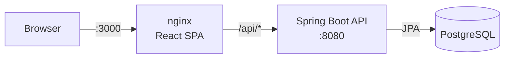

# Reservations


A full-stack app to book shared resources (meeting rooms, desks, equipment, vehicles), with JWT authentication,
role-based access, and double-booking protection enforced by the database.

> **Demo project.** Slotline is a portfolio piece: the spaces it lists are not real, and the public demo, if any,
> is not meant for real bookings or real personal data.

**Stack:** Java 25 · Spring Boot 4 (Web MVC, Security, Data JPA, Validation) · PostgreSQL 17 · Flyway ·
React 19 + TypeScript (Vite) · JUnit 5 · Mockito · Testcontainers · OpenAPI/Swagger · Docker Compose · GitHub Actions

## Run it

```bash
docker compose up --build
```

| What | URL |
|------|-----|
| App | http://localhost:3000 |
| Swagger UI | http://localhost:8080/swagger-ui.html |
| Health | http://localhost:8080/actuator/health |

Demo admin: `admin@reservas.dev` / `admin12345` (change it with `ADMIN_EMAIL` / `ADMIN_PASSWORD`).
Anyone can register as a regular user from the login screen.

## Features

- Register and log in with stateless JWTs (HS256) in httpOnly cookies: a 15-minute access token renewed by a 7-day refresh token, with CSRF protection; passwords are hashed with BCrypt
- Two roles: **USER** books resources and manages their own reservations; **ADMIN** manages resources and sees every reservation
- Resource search with name, type and minimum-capacity filters, pagination and sorting
- Reservations with validation: start time in the future, end after start, a maximum of 12 hours, and no overlaps
- **Availability view:** a week strip and half-hour grid show which slots of a resource are free before you pick a time
- **Edit bookings:** change the time and/or the resource of an upcoming booking, with the same rules as a new one
- **Recurring bookings:** daily or weekly, up to 12 dates, all or nothing (if one date is taken, none is booked and the API lists the colliding dates); cancel one date or the rest of the series
- **Approval flow:** admins mark expensive resources as *needs approval*; bookings on them stay `PENDING` (and hold the slot) until an admin approves or rejects them
- **Audit trail:** every create, edit, cancel, approve, reject and resource change is recorded with who and when; admins browse it in *Activity*
- **Email previews:** a mockup of the confirmation, reminder and cancellation emails. Nothing is sent yet; it shows the planned flow
- A single error format for the whole API ([RFC 9457 Problem Details](https://www.rfc-editor.org/rfc/rfc9457)), including field-level validation errors

## Architecture



```
backend/src/main/java/com/reservas
├── auth/          register, login, JWT issuing
├── resource/      bookable resources (admin CRUD, search)
├── reservation/   bookings, availability, edits, series, approvals
├── audit/         append-only change history
├── user/          user entity and roles
├── config/        security, OpenAPI, first admin
└── common/        API exceptions → Problem Details
```

Each feature package holds its own controller, service, repository and DTOs, so related code stays together.

## Technical decisions

**Double booking is prevented by the database, not just the code.** The service checks for overlaps first so it
can return a clear `409`, but two concurrent requests could both pass that check. A PostgreSQL exclusion
constraint (`EXCLUDE USING gist (resource_id WITH =, tstzrange(start_time, end_time) WITH &&)`) makes the second
insert fail no matter what. An integration test bypasses the service on purpose to prove it.

**Spring Security's own JWT support instead of a third-party library.** The API is an OAuth2 resource server
using `NimbusJwtEncoder` and `NimbusJwtDecoder`, so signing, expiry and validation come from a maintained
framework instead of custom filter code. The signing key comes from the environment and the app refuses to start
without it.

**Tokens in httpOnly cookies, not `localStorage`.** Page scripts never see a token, so an XSS bug cannot steal the
session. Both cookies are `Secure` and `SameSite=Strict`; the refresh cookie is scoped to `/api/auth/refresh`, and
a `token_use` claim stops a refresh token from being used as an access token. Because the browser now sends
credentials by itself, writes require Spring Security's CSRF token (`XSRF-TOKEN` cookie echoed in a header).

**Same origin, no CORS.** nginx serves the SPA and proxies `/api` to the backend, and Vite's dev server does the
same. The browser only ever talks to a single origin.

**Pending requests hold their slot.** The exclusion constraint covers `PENDING` and `CONFIRMED` rows, so an
approval can never create a double booking. Postgres checks it on `UPDATE` too, so edits are covered as well.

**Audit entries share the change's transaction** (`Propagation.MANDATORY`): a change and its history entry commit or
roll back together, so the log cannot drift from the data.

**Soft delete for resources.** Deactivating a resource keeps its reservation history intact.

**`404` instead of `403` for other users' reservations**, so ids cannot be probed.

**Schema owned by Flyway** (`ddl-auto=validate`): Hibernate checks that the entities match the migrations but never
changes the schema.

## Tests

```bash
cd backend && ./mvnw verify    # needs Docker running for Testcontainers
```

- `ReservationServiceTest`: unit tests of the booking rules with Mockito
- `ApiIntegrationTest`: the full HTTP flow against a real PostgreSQL in a container (auth, roles, validation, pagination, overlap, edits, series, approvals, availability, audit, and the database constraint on inserts and updates)

CI runs both, plus the frontend lint and build and a Docker image build, on every push. `verify` also writes a JaCoCo
coverage report to `backend/target/site/jacoco/index.html`, which CI uploads as the `coverage-report` artifact.

## Local development without Docker Compose

```bash
cd backend && ./mvnw spring-boot:test-run   # API + a throwaway PostgreSQL container
cd frontend && npm install && npm run dev   # http://localhost:5173, proxies /api to :8080
```

## Known limitations / next steps

- Refresh tokens are stateless, so signing out clears the cookies but cannot revoke a token copied before; storing them would allow rotation and revocation
- Emails are a visual mockup only: there is no mail sending or scheduled reminder yet
- Recurring dates step in fixed 24h/7d blocks (UTC), so in time zones with daylight saving the local hour shifts once
- Next steps: Prometheus/Grafana metrics, a coverage badge, and a cloud deployment

## How this was built

Built with assistance from [Claude Code](https://claude.com/claude-code) (AI). Requirements, design decisions, code
review and testing are mine; commits written with the assistant carry a `Co-Authored-By: Claude` trailer.

## License

[MIT](LICENSE)
