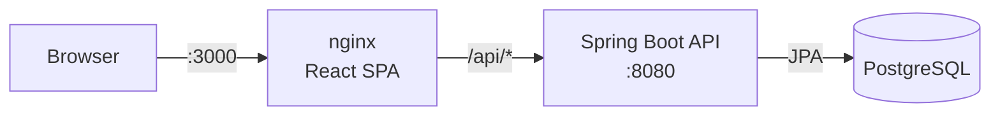

# Reservations


A full-stack app to book shared resources (meeting rooms, desks, equipment, vehicles), with JWT authentication,
role-based access, and double-booking protection enforced by the database.

**Stack:** Java 25 · Spring Boot 4 (Web MVC, Security, Data JPA, Validation) · PostgreSQL 17 · Flyway ·
React 19 + TypeScript (Vite) · JUnit 5 · Mockito · Testcontainers · OpenAPI/Swagger · Docker Compose · GitHub Actions

## Run it

```bash
docker compose up --build
```

| What | URL |
|------|-----|
| App | http://localhost:3000 |
| Swagger UI | http://localhost:8080/swagger-ui.html |
| Health | http://localhost:8080/actuator/health |

Demo admin: `admin@reservas.dev` / `admin12345` (change it with `ADMIN_EMAIL` / `ADMIN_PASSWORD`).
Anyone can register as a regular user from the login screen.

## Features

- Register and log in with a stateless JWT (HS256); passwords are hashed with BCrypt
- Two roles: **USER** books resources and manages their own reservations; **ADMIN** manages resources and sees every reservation
- Resource search with name and type filters, pagination and sorting
- Reservations with validation: start time in the future, end after start, a maximum of 12 hours, and no overlaps
- A single error format for the whole API ([RFC 9457 Problem Details](https://www.rfc-editor.org/rfc/rfc9457)), including field-level validation errors

## Architecture



```
backend/src/main/java/com/reservas
├── auth/          register, login, JWT issuing
├── resource/      bookable resources (admin CRUD, search)
├── reservation/   bookings, overlap checks, cancellation
├── user/          user entity and roles
├── config/        security, OpenAPI, first admin
└── common/        API exceptions → Problem Details
```

Each feature package holds its own controller, service, repository and DTOs, so related code stays together.

## Technical decisions

**Double booking is prevented by the database, not just the code.** The service checks for overlaps first so it
can return a clear `409`, but two concurrent requests could both pass that check. A PostgreSQL exclusion
constraint (`EXCLUDE USING gist (resource_id WITH =, tstzrange(start_time, end_time) WITH &&)`) makes the second
insert fail no matter what. An integration test bypasses the service on purpose to prove it.

**Spring Security's own JWT support instead of a third-party library.** The API is an OAuth2 resource server
using `NimbusJwtEncoder` and `NimbusJwtDecoder`, so signing, expiry and validation come from a maintained
framework instead of custom filter code. The signing key comes from the environment and the app refuses to start
without it.

**Same origin, no CORS.** nginx serves the SPA and proxies `/api` to the backend, and Vite's dev server does the
same. The browser only ever talks to a single origin.

**Soft delete for resources.** Deactivating a resource keeps its reservation history intact.

**`404` instead of `403` for other users' reservations**, so ids cannot be probed.

**Schema owned by Flyway** (`ddl-auto=validate`): Hibernate checks that the entities match the migrations but never
changes the schema.

## Tests

```bash
cd backend && ./mvnw verify    # needs Docker running for Testcontainers
```

- `ReservationServiceTest`: unit tests of the booking rules with Mockito
- `ApiIntegrationTest`: the full HTTP flow against a real PostgreSQL in a container (auth, roles, validation, pagination, overlap, cancellation, and the database constraint)

CI runs both, plus the frontend lint and build and a Docker image build, on every push.

## Local development without Docker Compose

```bash
cd backend && ./mvnw spring-boot:test-run   # API + a throwaway PostgreSQL container
cd frontend && npm install && npm run dev   # http://localhost:5173, proxies /api to :8080
```

## Known limitations / next steps

- The token is kept in `localStorage`; a production app would use an httpOnly cookie with refresh tokens
- No availability calendar yet: overlaps are reported when you submit a booking
- Next steps: Prometheus/Grafana metrics, a coverage badge (JaCoCo), and a cloud deployment
